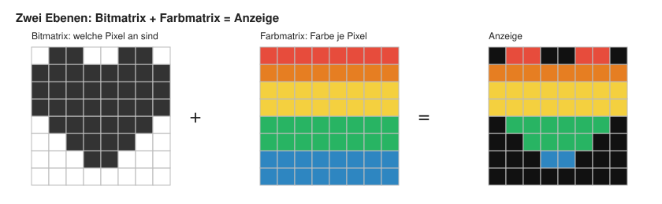
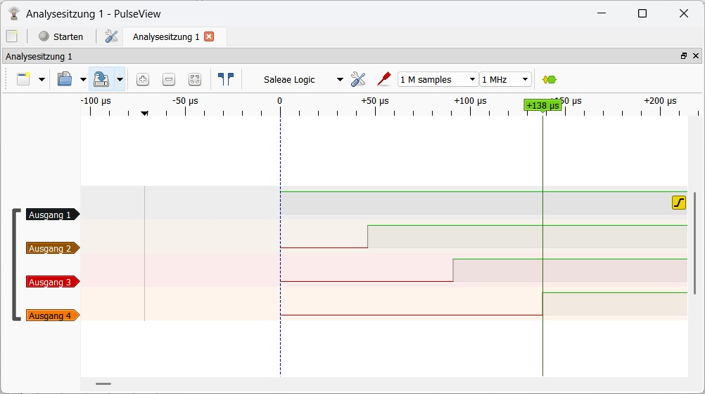
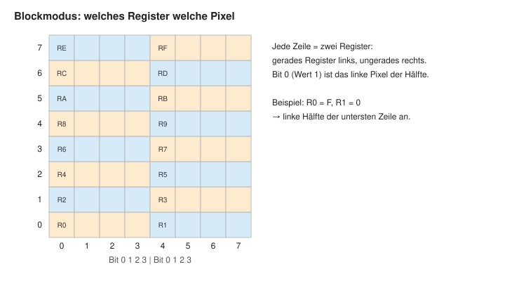
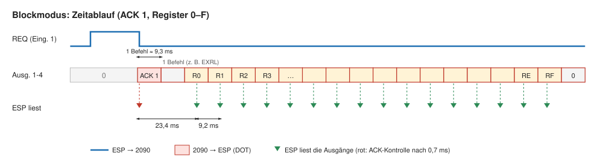
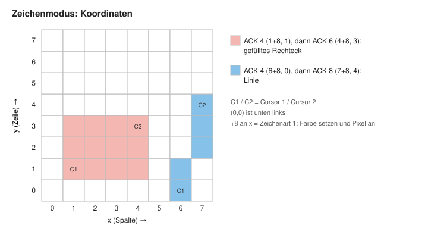
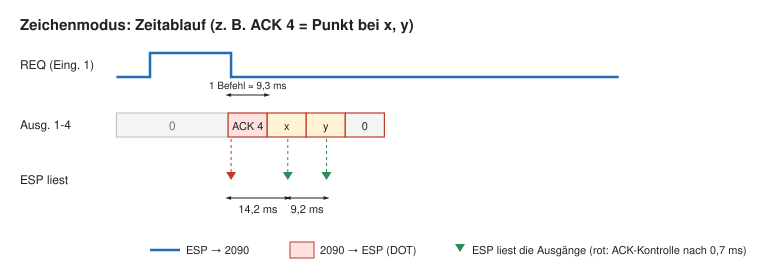
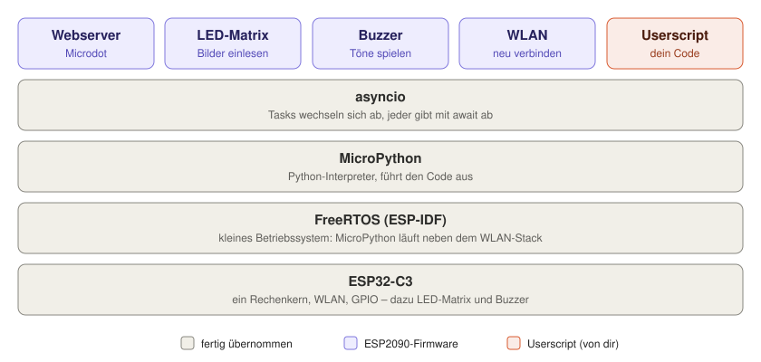

# Bring deinen Busch Microtronic 2090 ins 21. Jahrhundert!


Das ESP2090-Studio verbindet den klassischen Lerncomputer Busch Microtronic 2090 mit einem modernen ESP32. ESP2090 erweitert den Microtronic um flexible, programmierbare Peripherie.

Der Grundgedanke ist einfach: Der Microtronic bleibt das originale 4-Bit-System – das ESP2090-Studio sorgt dafür, dass er plötzlich Dinge kann, die er ursprünglich nie konnte, ohne ihn selbst zu ersetzen. Wir verbinden dafür die Ein- und Ausgänge des Microtronic mit einem [ESP32](https://de.wikipedia.org/wiki/ESP32), auf dem [MicroPython](https://micropython.org) läuft. So können benutzerdefinierte Python-Programme über festgelegte Funktionen und Protokolle mit dem Microtronic interagieren. 

Vom einfachen Blinklicht über anpassbaren Zufallszahlengenerator, 2095-Tape-Emulator, Tongenerator, beliebige Sensoren, Internet-Anbindung bis hin zu einem 8x8-Matrix-LED-"Bildschirm" für den Microtronic - über die Weboberfläche des ESP2090-Studios lässt sich alles konfigurieren und steuern. 


## Inhalt

- [Materialliste (BOM)](#materialliste-bom)
- [Warum nur, warum?](#warum-nur-warum)
- [Schaltung](#schaltung) – [Stromversorgung](#stromversorgung)
- [Schnellstart: Firmware installieren](#schnellstart-firmware-installieren)
- [Was kann ich damit machen?](#was-kann-ich-damit-machen)
- [Userscripts: der ESP2090 als Peripherie](#userscripts-der-esp2090-als-peripherie)
- [Die LED-Matrix als Bildschirm](#die-led-matrix-als-bildschirm)
- [Die Firmware: wie das ESP2090 innen tickt](#die-firmware-wie-das-esp2090-innen-tickt)
- [Projekte mit dem ESP2090](#projekte-mit-dem-esp2090)
- [Lizenz](#lizenz)


## Materialliste (BOM)

| Menge | Artikel | Preis (04/26) | Bemerkung |
| ---: | :--- | ---: | :--- |
| 1 | ESP32-C3 SuperMini | 1,70 | |
| 1 | SN74HCT244 8-fach Treiber | 2,60 | (10 St.) |
| 1 | CD4071 4-fach Oder-Gatter | 1,70 | (10 St.) |
| 2 | 4ch-2way-Levelshifter | 1,70 | (10 St., richtige Bauform beachten) |
| 1 | Buzzer, passiv | 1,50 | (10 St.) |
| 4 | Widerstand 470 Ohm | 2,00 | (Sortiment Widerstände 300 St.) |
| 4 | Widerstand 10k Ohm | - | (s.o.) |
| 1 | Widerstand 220 Ohm | - | (s.o.) |
| 1 | Widerstand 100 Ohm | - | (s.o.) |
| 2 | Kondensator 100 nF | 2,30 | (Sortiment Kondensatoren 300 St.) |
| 1 | Pfostenleiste 2,54 mm | 1,80 | (Sortiment male + female 20 St., benötigt male: 1 x 5, 1 x 3) |
| 1 | Buchsenleiste 2,54 mm | - | (s.o., benötigt female: 2 x 8 für ESP32) |
| 1 | IC-Sockel 14-polig | 2,20 | (Sortiment 66 St., für CD4071)
| 1 | IC-Sockel 20-polig | - | (s.o., für 74HCT244) |
| 18 | Metallösen 2,5 mm Innendurchmesser | 1,80 | (Sortiment 100 St., Stichwort: rivet, eyelet) |
| 1 | [Platine (PCB)](https://github.com/rab-berlin/ESP2090/tree/main/gerbers) | 9,00 | (5 St. aus Fernost - oder von mir, falls noch da) |
| 1 | WS2812B-LED-Matrix 8x8 | 1,80 | |
| 1 | Netzteil 5V 3A USB-C | 3,30 | |

Die Preise sind von AliExpress. Wer das alles frisch ordert, kommt ohne Platine für etwa 20 Euro weg - und hat danach noch viele Ersatzteile übrig. Ich bin aber sicher, dass du das meiste sowieso schon vorrätig hast. Lediglich den ESP, die Metallösen, die Platine und wahrscheinlich die LED-Matrix musst du wohl bestellen.

**Nachtrag 11/2026:** Inzwischen gibt es leider neue Zölle auf Lieferungen aus China, und das trifft unser Hobby sehr: 3 Euro pauschal auf jede *Warengruppe*. Widerstände, Kondensatoren, ICs, Steckleisten usw. sind verschiedene Gruppen – also jeweils 3 Euro obendrauf. Bei den Kleinteil-Sortimenten oben ist das schnell mehr als der Warenwert. Man muss abwarten, ob das noch besser wird oder ob andere günstige Bezugsquellen kommen – aber die wenigen Lötkolbenverrückten haben nun mal keine Lobby.

Du kannst natürlich auch ohne IC-Sockel und Buchsenleisten alles direkt auf die Platine löten. Ich persönlich hab´s aber lieber flexibel - versuch mal, einen falsch eingelöteten oder nicht funktionierenden IC wieder auszulöten...

Wer es richtig schön will, druckt sich noch einen passenden Busch-Bauteilträger dazu aus. ~~Daran arbeite ich noch...~~ [SCAD-](https://github.com/rab-berlin/ESP2090/blob/main/3d/ESP2090_mit_Zapfen.scad) und STL-Datei. Zur Befestigung der Platine am Träger brauchst du vier winzige Schrauben M2 und passende Muttern.


## Warum nur, warum?

Für den Test von neu geschriebenen oder geänderten Programmen habe ich zunächst den prima [Emulator von Michael Wessel](https://github.com/lambdamikel/Busch-2090) verwendet. Am PC entwickelt, auf SD-Karte geschrieben, in den Emulator umgestöpselt und übertragen... Haltnextnullnullrun...

Als ich dann auch mal auf dem "echten" Microtronic testen wollte, stieß ich - unter anderem - auf den Unterschied zwischen zufälligem und nicht so zufälligem Zufall. Also ergaben sich neue Notwendigkeiten:

- mehr auf dem originalen Busch Microtronic 2090 testen
- besondere Peripherie für meine Programme anschließen

Daher habe ich dann einen Raspberry Pi Zero W eingesetzt. Ein Python-Skript und ein paar Kabel mit Levelshifter übernahmen die Funktion des 2095-Kassetteninterfaces, und so konnte ich meine Ideen relativ schnell und unkompliziert über WLAN auf den Pi und von dort auf den Original-2090 bringen.

Für einige dieser neuen Programme wiederum benötigte ich manchmal auch Peripherie am Microtronic, die ich nicht immer mit Busch-Baukästen umsetzen konnte (oder wollte). Das erledigte zuerst ein Arduino Nano mit entsprechendem C-Programm, anschließend übernahm der Pi auch diese Aufgabe.

Der Raspberry Pi (also auch der von mir verwendete Zero) ist im Prinzip ein vollwertiger Computer mit Linux-Betriebssystem. Damit konnte ich natürlich alle Peripherie-Aufgaben bequem erledigen, und der Pi wäre auch eine bestens geeignete Hardware-Grundlage für alle weiteren Vorhaben gewesen. Irgendwie störte mich aber der Gedanke, dass zwischen dem Microtronic und dem Pi ein so großes _intellektuelles Gefälle_ herrschte. Ich wollte stattdessen, dass sich zwei Microcontroller "auf Augenhöhe" miteinander unterhalten - wenn auch mit 45 Jahren Altersunterschied. 

Was mich außerdem störte, ist die Preisentwicklung bei der Raspberry Pi Foundation. Es fing mal an als Experimentiercomputer zu einem Preis, den sich jeder lernwillige Einsteiger leisten konnte. Inzwischen werden teilweise Preise von 200 Euro für einen ausgebauten Pi aufgerufen. Obwohl es sicher gute Gründe dafür geben mag, ist das (für mich) nicht mehr unterstützenswert.

Die Leitidee sollte sein: Mit so wenig wie möglich so viel wie möglich erreichen. 

Meine Wahl fiel dann auf den ESP32 - nicht zuletzt, weil ich den Vorgänger ESP8266 in der Arduino-Umgebung schon öfter benutzt hatte. Der erste Gedanke war dann auch, dem ESP alles, was er wissen muss, in C beizubringen, um als idealer peripherer Begleiter für den Microtronic zu dienen. Einige gedankliche Iterationen später war die Frage dann aber: Wäre es nicht noch schöner, wenn man zur Laufzeit neue Ideen testen könnte, ohne die Firmware über die Arduino-IDE jeweils neu programmieren und flashen zu müssen? Wenn man also beliebige User-Skripte zur Laufzeit direkt aufrufen und ausführen könnte? 

C und Arduino-IDE fielen damit raus. Python rückte ins Zentrum, weil es zur Laufzeit interpretiert wird, und der Microtronic sowieso kein Geschwindigkeitsmonster ist. Genauer gesagt, die Wahl fiel auf MicroPython - womit die Ideen letztlich alle umsetzbar schienen. Und außerdem wollte ich mal wieder was neues lernen.

Entsprechend der Leitidee _Reduce to the max_ sollte es dann der ESP32-C3-Supermini sein, da dieser nur ca. 2 Euro kostet und genug GPIOs bietet für alle Ein- und Ausgänge des Microtronic sowie für ein bisschen zusätzliche Funktionen. 

## Schaltung

Die [Schaltung des ESP2090-Studios](https://github.com/rab-berlin/ESP2090/blob/main/documents/ESP2090.pdf) ist verhältnismäßig einfach. 

Der ESP32 arbeitet mit 3,3 Volt Betriebsspannung, der Microtronic hingegen mit 5 Volt (genauer gesagt: sogar 5,7 Volt - nachmessen!). Daher sind in den Signalwegen jeweils Levelshifter eingebaut. Da wir es mit verhältnismäßig langsamen Signalen im Bereich von Millisekunden zu tun haben, muss man über die Schaltgeschwindigkeit der Levelshifter nicht besonders intensiv nachdenken. Billige Teile aus China funktionieren gut.

Ich habe darauf geachtet, dass die Ein- und Ausgänge des Microtronic elektrisch vom ESP entkoppelt sind, das heißt, sie sollten auch bei gleichzeitigem Anschluss des ESP2090-Studios nach wie vor nutzbar bleiben, falls z.B. weitere Peripherie aus dem Busch-Sortiment verwendet wird. Für diese Entkopplung werden zwei ICs eingesetzt, ein CD4071 und ein 74HCT244.

### Eingänge

Jeder Eingang des Microtronic ist an je einen Ausgang eines ODER-Gatters (CD4071) angeschlossen. Je ein Eingang eines ODER-Gatters ist mit einem GPIO des ESP32 verbunden, der andere Eingang des Gatters ist "frei" (kann also wie bisher als Eingang des 2090 genutzt werden). So können weiterhin beliebige Peripherie-Schaltungen an den Microtronic angeschlossen werden - ohne dass es zu elektrischer Beeinflussung durch den ESP32 kommt. 

Die Eingänge des 4071 sind extrem hochohmig, über Ströme muss man sich also keine Gedanken machen.

### Ausgänge 

Jeder Ausgang des Microtronic ist an je zwei Eingänge eines 74HCT244 angeschlossen. Dadurch wird ein Microtronic-Ausgang praktisch "verdoppelt" - eine Ausgangskopie bleibt unabhängig nutzbar, daran kann also wie bisher beliebige (Busch-)Peripherie angeschlossen werden. Die andere Ausgangskopie ist mit einem GPIO des ESP verbunden. Dadurch kann das ESP2090-Studio alle Veränderungen an den Ausgängen des Microtronic überwachen, ohne eventuell angeschlossene andere Peripherie elektrisch zu stören. 

Es ist zu beachten, dass der 74HCT244 maximal 20 mA an seinen Ausgängen liefert. Mehr sollte man auch dem Microtronic niemals abverlangt haben, wenn man seine Ausgänge nicht überlasten wollte - laut Anleitungsbuch 2. Teil, S. 41: "maximal 15 mA". Wer mehr will oder braucht, steuert mit dem Ausgang wie üblich erstmal einen Transistor an.

### Stromversorgung

Das ESP2090-Studio bekommt seine 5 Volt über die USB-C-Buchse des ESP32-C3 SuperMini – entweder vom PC oder von einem USB-Netzteil (5 V, Typ C). Von dort laufen sie über den 5V-Pin des SuperMini zu den ICs, den Levelshiftern und der LED-Matrix. Vom Microtronic kommt kein Strom: Mit ihm sind nur die Masse und die Signalleitungen verbunden, der 2090 behält seine eigene Versorgung.

Der größte Verbraucher ist die LED-Matrix. 64 LEDs in voller Helligkeit (weiß) würden bis zu 3,8 A ziehen – das schafft weder ein PC-Port (500 mA bei USB 2.0, 900 mA bei USB 3) noch die Leiterbahnen des SuperMini. Die Firmware begrenzt deshalb den Strom der Matrix (`LED_MAX_MA = 250` in `main.py`). Das reicht auch am PC-Port. Mit eigenem Netzteil ab 2 A kann man den Wert bis etwa 1000 erhöhen. Ist der PC angeschlossen, hängt übrigens die Masse des 2090 über das ESP2090 an der PC-Masse – in der Regel kein Problem, aber gut zu wissen.

**Reihenfolge beim Einschalten:** Ist der ESP stromlos, der Microtronic aber eingeschaltet, fließen je Ausgang des 74HCT244 etwa 4 mA Richtung ESP. Dadurch leuchtet sogar die LED auf dem ESP32-C3. Das ist nur kosmetisch und schadet nicht, denn die Ausgänge dürfen bis 15 mA liefern. Am besten aber immer **zuerst den ESP einschalten**, dann den 2090 – dann sind alle Verbindungen hochohmig. Beim Ausschalten umgekehrt.

## Schnellstart: Firmware installieren

Die ausführliche Anleitung mit Fehlersuche steht in [firmware/ANLEITUNG.txt](firmware/ANLEITUNG.txt), die Funktionen für Userscripts in [firmware/README.md](firmware/README.md). In Kürze:

1. **MicroPython flashen** (einmalig): [Thonny](https://thonny.org) installieren, ESP per USB-C anschließen (ein Datenkabel, kein reines Ladekabel). Unter *Werkzeuge → Optionen → Interpreter* „MicroPython (ESP32)“ wählen und *MicroPython installieren* mit Familie und Variante **ESP32-C3**. Erprobt mit MicroPython 1.27.0 und 1.29.0. Wird der ESP nicht erkannt: BOOT-Taste beim Einstecken gedrückt halten.
2. **WLAN eintragen:** `wifi.json.beispiel` als `wifi.json` kopieren und WLAN-Name und Passwort eintragen. Ohne diese Datei öffnet der ESP ein eigenes WLAN „ESP32-Setup“ (Passwort 12345678), dort unter http://192.168.4.1 das WLAN auswählen.
3. **Dateien kopieren:** In Thonny (*Ansicht → Dateien*) aus dem Ordner `firmware` diese Dateien **und den Ordner `userscripts`** auf den ESP hochladen: `boot.py`, `hw.py`, `main.py`, `matrix_draw.py`, `basicweb.py`, `microdot.py`, `index.html`, `webrepl_cfg.py` sowie die eigene `wifi.json`. Vorher in `webrepl_cfg.py` das WebREPL-Passwort ändern.
4. **Starten:** RST am ESP drücken. In der Thonny-Shell erscheint die IP-Adresse, dann im Browser **http://&lt;IP-Adresse&gt;:8080** öffnen (das `:8080` nicht vergessen).

## Was kann ich damit machen?

Die einfache Antwort: alles. 

Prinzipiell brauchst du nur ein passendes Python-Script auf dem ESP2090, welches auf die Signale an den vier Ausgängen des Microtronic passend reagiert und - falls nötig - die richtigen Signale zur gewünschten Zeit an die Eingänge des Microtronic sendet. 

Die ernüchternde Antwort: natürlich nicht alles, weil der Programmspeicher des Microtronic eben doch nur 256 Befehle umfasst. Und die Anzahl der Register mit 16 (plus 16 Speicherregister) auch recht begrenzt ist.

Der Spaß liegt wie immer darin, mit diesen Einschränkungen eben doch etwas zu schaffen, das "sinnvoll" und funktional ist.

## Userscripts: der ESP2090 als Peripherie

Ein Userscript ist ein kleines Python-Programm, das auf dem ESP2090 läuft und mit dem Microtronic über dessen Ein- und Ausgänge spricht. Du schreibst es im Editor der Weboberfläche, speicherst es im Ordner `userscripts` auf dem ESP und startest es mit **Run** (und beendest es mit **Stop**). Ein Neuflashen der Firmware ist dafür nie nötig.

Welche Funktionen ein Userscript benutzen kann (`setOutputs`, `getInputs`, `beep`, `log`, `tasteG` …), steht in der [Beschreibung der Firmware](firmware/README.md).

### Wer sendet wohin?

Die Namen in den Userscripts sind aus Sicht des ESP gewählt:

| im Userscript | am 2090 | Richtung | auf dem 2090 |
|---|---|---|---|
| `setOutputs(wert)`, `out_1` … `out_4` | Eingänge 1–4 | ESP → 2090 | `DIN Rx` liest den Wert |
| `getInputs()`, `in_1` … `in_4` | Ausgänge 1–4 | 2090 → ESP | `DOT Rx` gibt den Wert aus |

Wert 1 ist jeweils Ein- bzw. Ausgang 1, Wert 8 Ein- bzw. Ausgang 4. Die originalen Klemmen des 2090 bleiben dabei nutzbar: Die Eingänge sind mit den Signalen des ESP verODERt, die Ausgänge werden für den ESP nur mitgelesen.

### Protokolle: Nibbles und Zeit

Wenn du bisher noch nie etwas mit Protokollen zu tun haben wolltest (hast du aber, weil du gerade im Internet unterwegs bist) – jetzt solltest du damit anfangen, wenn du dem Microtronic die _Welt der Dinge_ zugänglich machen willst.

Ein Protokoll ist nichts weiter als eine Verabredung: Wer legt wann welches Nibble auf die Leitungen, und woran erkennt der andere, dass er es lesen darf? Der Microtronic hat vier Ausgänge und vier Eingänge, mehr nicht – aber das reicht für erstaunlich viel. Zwischen ihm und dem ESP laufen also nur 4 Bit in jede Richtung, und keiner kann dem anderen „Bescheid sagen“, außer über genau diese Leitungen. Damit trotzdem nichts verloren geht, verabreden das Programm im 2090 und das Userscript eine Reihenfolge – eben ein **Protokoll**. Die LED-Matrix ist ein Sonderfall mit einem fest eingebauten Protokoll, sie hat [einen eigenen Abschnitt](#die-led-matrix-als-bildschirm). Für Userscripts reichen zwei Muster für sehr vieles:

**1. Nur in eine Richtung.** Einer legt einen Wert an, der andere schaut regelmäßig nach. Damit das klappt, muss der Wert lange genug anliegen. Das Userscript schaut in den Beispielen alle 5 ms nach, der 2090 braucht für einen Befehl etwa 9,3 ms (mit eingeschalteter Anzeige länger). Ein Wert, den der 2090 für vier oder fünf Befehle stehen lässt, kommt also sicher an. Umgekehrt sollte das Userscript einen Wert so lange halten, bis der 2090 ihn gelesen hat – oder deutlich länger, als die Leseschleife im 2090 braucht.

**2. Anfrage und Antwort (Handshake).** Der 2090 stellt eine Frage (z. B. Ausgang 1 an), das Userscript antwortet auf den Eingängen und wartet, bis der 2090 „fertig“ meldet (Ausgänge wieder 0). Erst dann räumt es seine Antwort weg. So spielt es keine Rolle, wie schnell der eine oder der andere gerade ist.

Ein paar Hinweise aus der Praxis:

- **Nicht auf feste Zeiten bauen.** Mit eingeschalteter Anzeige ist der 2090 langsamer, und auch der ESP hat nebenbei zu tun (Webserver). Lieber warten, bis sich etwas ändert, als eine bestimmte Zeit abzuzählen. Feste Zeiten braucht nur die [LED-Matrix](#die-led-matrix-als-bildschirm), die deshalb in der Firmware eingebaut ist.
- **Ausgänge schalten nacheinander.** Ein `DOT` des 2090 schaltet die vier Ausgänge nicht gleichzeitig, sondern nacheinander: Nach der ersten erkennbaren Änderung dauert es noch etwa 138 µs (auf high) bzw. 166 µs (auf low), bis der Wert vollständig anliegt (Bild im Abschnitt [Wie die Übertragung abläuft](#wie-die-übertragung-abläuft)). Wer genau dann liest, bekommt einen Zwischenwert. Wo es darauf ankommt: nach einer Änderung kurz warten (1 ms) und noch einmal lesen.
- **Ruhezustand 0.** Wenn alle Ausgänge auf 0 stehen, „sagt niemand etwas“. Wer einen Wert gesendet hat, setzt am Ende wieder 0.
- **Matrix und Userscript nicht gleichzeitig an denselben Leitungen.** Die LED-Matrix benutzt Eingang 1 (Anfrage) und alle vier Ausgänge. Wer die Matrix eingeschaltet hat („LED on“), sollte kein Userscript laufen lassen, das ebenfalls darauf hört oder Eingang 1 setzt.

### Regeln für Userscripts

Userscripts laufen neben Webserver und Matrix auf demselben kleinen Prozessor. Damit alle drankommen, muss jedes Script die Kontrolle regelmäßig abgeben:

- In jeder Schleife `await asyncio.sleep_ms(...)` verwenden, nie `time.sleep`.
- Kein `input()`.

Vor dem Start prüft der ESP das Script und startet es nicht, wenn eine `while`- oder `for`-Schleife kein `await` enthält (Ausnahme: `for ... in range(n)` mit einer festen Zahl bis 64). Beim Speichern erscheint schon eine Warnung. Nach dem Ende oder bei **Stop** werden die Ausgänge auf 0 gesetzt und ein Ton beendet.

### Beispiele für Userscripts

Zu jedem Beispiel gehört ein Programm für den 2090 (`.mic`, ausführlich kommentiert, zum Hochladen mit **Upload**) und ein Userscript (`.py`). Die Programme sind kurz genug, um sie auch von Hand einzutippen.

**So startest du ein Beispiel:**

1. Den Inhalt der `.py`-Datei in den Editor der Weboberfläche kopieren und unter einem Namen speichern (z. B. `ton.py`) – noch **nicht** starten.
2. Das Programm (`.mic`) mit **Upload** zum 2090 übertragen.
3. Erst jetzt das Userscript mit **Run** und das Programm auf dem 2090 starten.

Die Reihenfolge ist wichtig: Der Upload benutzt dieselben Ein- und Ausgänge wie Userscript und Programm. Deshalb nie hochladen, während schon ein Userscript oder ein Programm auf dem 2090 läuft. Die Matrix muss dabei aus sein.

#### Lauflicht – nur der ESP

[firmware/userscripts/beispiel_lauflicht.py](firmware/userscripts/beispiel_lauflicht.py) liegt schon auf dem ESP. Es schaltet die Eingänge des 2090 im Halbsekundentakt nacheinander ein (Wert 1, 2, 4, 8). Gut zum Ausprobieren, ob alles verbunden ist. Sichtbar wird es mit drei Befehlen auf dem 2090, die die Eingänge laufend anzeigen:

```
00  FD0  DIN R0
01  F10  DISP 1,R0
02  C00  GOTO 00
```

#### Ton – der 2090 als Klavier (eine Richtung: 2090 → ESP)

[program/ton](program/ton): Die Tasten 1–F am 2090 spielen eine C-Dur-Tonleiter über zwei Oktaven auf dem Buzzer des ESP2090.

- **2090** (10 Befehle): wartet mit `KIN` auf eine Taste, zeigt sie an, legt sie mit `DOT` auf die Ausgänge, lässt sie vier `NOP` lang stehen und setzt die Ausgänge wieder auf 0.
- **Userscript:** schaut alle 5 ms auf die Ausgänge des 2090. Bei jedem neuen Wert ungleich 0 spielt es 300 ms lang den passenden Ton.

```python
TOENE = [0, 262, 294, 330, 349, 392, 440, 494,
         523, 587, 659, 698, 784, 880, 988, 1047]
alt = 0
while True:
    wert = getInputs()
    if wert != alt:
        if wert != 0:
            beep(TOENE[wert], 300)
        alt = wert
    await asyncio.sleep_ms(5)
```

Weil der 2090 nach jedem Ton wieder 0 ausgibt, klingt auch dieselbe Taste zweimal hintereinander zweimal.

#### Web-Taster – Zähler mit G und H (eine Richtung: ESP → 2090)

[program/webtaster](program/webtaster): Die Tasten **Key G** und **Key H** der Weboberfläche (oder Leertaste und H auf der Tastatur) zählen auf dem 2090 hoch und herunter.

- **Userscript:** legt G auf Eingang 1 und H auf Eingang 2, solange die Taste gedrückt ist (in der Weboberfläche 0,5 s).
- **2090** (16 Befehle): liest die Eingänge mit `DIN`, zählt bei Eingang 1 hoch, bei Eingang 2 herunter und wartet dann, bis keine Taste mehr anliegt – sonst würde er während der halben Sekunde ständig weiterzählen.

```python
while True:
    wert = 0
    if tasteG["pressed"]:
        wert = wert | 1
    if tasteH["pressed"]:
        wert = wert | 2
    setOutputs(wert)
    await asyncio.sleep_ms(20)
```

#### Zufallszahl – Anfrage und Antwort (beide Richtungen)

[program/zufallszahl](program/zufallszahl): Jede Taste am 2090 holt eine echte Zufallszahl 0–F vom ESP und zeigt sie an. Der ESP32 hat einen Zufallsgenerator in Hardware – ein Zufall, der deutlich zufälliger ist als der des 2090.

Das Protokoll ist ein Handshake:

1. **2090:** Ausgang 1 an (Anfrage).
2. **ESP:** legt die Zahl auf die Eingänge 1–4.
3. **2090:** wartet ein paar Befehle, liest die Zahl mit `DIN`.
4. **2090:** Ausgänge auf 0 (fertig) – erst dann setzt der ESP die Eingänge wieder auf 0.

```python
import os
while True:
    if getInputs() == 1:                    # Anfrage vom 2090
        zahl = os.urandom(1)[0] & 15
        setOutputs(zahl)                    # Antwort
        while getInputs() != 0:             # warten, bis der 2090 fertig ist
            await asyncio.sleep_ms(5)
        setOutputs(0)
    await asyncio.sleep_ms(5)
```

Auf diesem Muster lässt sich vieles aufbauen: Messwerte von einem Sensor, die Uhrzeit aus dem Internet, ein zweites Nibble für größere Zahlen (einfach zweimal fragen) …

## Die LED-Matrix als Bildschirm

Die 8x8-LED-Matrix ist ein Sonderfall der Kommunikation über die Ein- und Ausgänge: Der Microtronic schickt Daten über seine vier Ausgänge, das ESP2090-Studio liest sie und zeichnet. Im Unterschied zu den [Userscripts](#userscripts-der-esp2090-als-peripherie) ist das Protokoll fest in die Firmware eingebaut. Auf dem 2090 läuft dafür eine besondere Senderoutine, auf dem ESP muss nur die Matrix eingeschaltet sein (**„LED on“** in der Weboberfläche). Was die Matrix zeigt, erscheint auch live in der Weboberfläche.

Es gibt zwei Arten, die Matrix zu benutzen, und beide lassen sich in einem Programm mischen:

- **Blockmodus:** Der 2090 schickt ein ganzes Bild: 16 Register mit je 4 Bit = 64 Pixel. So arbeitet z. B. die [BerlinUhr2090](https://github.com/rab-berlin/BerlinUhr2090).
- **Zeichenmodus:** Der 2090 schickt kurze Befehle mit ein oder zwei Nibbles: Punkt, Rechteck, Rahmen, Linie, Farbe, Schieben … So kommt man mit wenigen Befehlen zu bunten Bildern und spart Register.

### Zwei Ebenen: Bitmatrix und Farbmatrix

Der ESP merkt sich das Bild in zwei Ebenen mit je 64 Einträgen:

- Die **Bitmatrix** sagt, **welche Pixel an sind** (1 Bit je Pixel).
- Die **Farbmatrix** sagt, **in welcher Farbe** ein Pixel leuchtet, wenn es an ist (eine der 16 Farben der Palette, siehe unten). Am Anfang ist sie überall rot.

Sichtbar ist: Pixel an → Farbe aus der Farbmatrix. Ist ein Pixel aus, ist es dunkel, egal welche Farbe für diese Stelle eingetragen ist.



Die Trennung ist praktisch: Die Farben legt man einmal fest (zum Beispiel Streifen wie oben, oder die Farben der BerlinUhr), danach schickt der 2090 nur noch, *welche* Pixel leuchten – die Farbe kommt automatisch mit. Umgekehrt kann man Farben ändern, ohne das Bild neu zu schicken.

Wer schreibt in welche Ebene?

| | Bitmatrix | Farbmatrix |
|---|---|---|
| Blockmodus (ganzes Bild) | ✓ | – |
| Zeichenmodus | je nach Zeichenart (siehe unten) | je nach Zeichenart |
| pop/peek (ACK 13) | ✓ (w = 6, 7, 10, 11) | ✓ (w = 5, 7, 9, 11) |
| Userscript `setColors(...)` | – | ✓ |

### Wie die Übertragung abläuft

Der 2090 hat keinen Takt, den der ESP sehen könnte. Die beiden verabreden deshalb einen Startzeitpunkt, und danach zählt der ESP einfach mit: **Bei ausgeschalteter Anzeige (`DISOUT`) braucht der 2090 für jeden Befehl ziemlich genau 9,3 ms.**

1. **Anfrage (REQ):** Der ESP setzt Eingang 1 des 2090 auf 1. Ein ACK erkennt er erst, nachdem die Ausgänge des 2090 einmal auf 0 standen.
2. **Antwort (ACK):** Der 2090 wartet in einer Schleife auf REQ (`DIN`, `ANDI`, `BRZ`) und legt dann mit `DOT` eine Befehlsnummer 1–15 auf seine Ausgänge. Der ESP erkennt sie, liest nach 0,7 ms zur Kontrolle noch einmal und nimmt REQ zurück.

   Die Kontrolle ist nötig, weil der 2090 langsam ist: Ein `DOT` schaltet die vier Ausgänge nicht gleichzeitig, sondern nacheinander. Sobald der ESP die erste Änderung erkennt (z. B. Ausgang 1 ist high), dauert es noch einmal etwa 138 µs, bis alle vier Ausgänge high sind – im Bild kommt Ausgang 4 erst bei +138 µs. Auf low fallen die Ausgänge noch langsamer, in etwa 166 µs. Würde der ESP den ersten Wert nehmen, den er sieht, bekäme er oft einen Zwischenwert. Nach 0,7 ms steht der Wert sicher.

   
3. **Daten:** Danach gibt der 2090 in jedem Befehlsschritt ein Nibble mit `DOT` aus, im Blockmodus 16, im Zeichenmodus ein oder zwei. Der ESP liest jeweils in der Mitte des Schritts. Die genauen Zeiten stehen bei den beiden Modi.
4. **Ende:** Der 2090 setzt seine Ausgänge wieder auf 0. Erst danach erkennt der ESP das nächste ACK – ein Wert, der auf den Ausgängen liegen bleibt, wird also nicht doppelt gelesen.

Antwortet der 2090 nicht innerhalb von 30 ms, nimmt der ESP REQ zurück, wartet kurz und fragt erneut. So bleibt die Weboberfläche bedienbar, auch wenn auf dem 2090 gerade kein passendes Programm läuft.

#### Schlafen und Wecken

Solange die Matrix eingeschaltet ist, fragt der ESP immer wieder mit REQ auf Eingang 1, und jeder Wert ungleich 0 auf den Ausgängen kann ein ACK sein. Programme, die Eingang 1 oder die Ausgänge selbst brauchen – Taster an Eingang 1, ein Keypad-Scan mit `DOT 1/2/4/8` und `DIN` –, lassen die Matrix deshalb zwischen den Bildern schlafen. Im Schlaf setzt der ESP kein REQ und beachtet auf den Ausgängen nur ein F. Das Bild bleibt stehen, die Weboberfläche zeigt einen gelben Punkt.

**Wecken: F anlegen und halten, bis REQ kommt.** Der ESP sieht nur in Abständen nach, ob ein F anliegt – meist nach wenigen Millisekunden, bei offener Weboberfläche auch erst nach 80 ms. Ein kurzes F kann er deshalb verpassen. Bleibt es stehen, bis er mit REQ antwortet, geht nichts verloren. Was dann passiert, hängt davon ab, was auf das F folgt:

| nach dem REQ | Wirkung |
|---|---|
| direkt das ACK (1–14) und seine Daten | **ein Befehl, danach schläft der ESP von selbst wieder** |
| erst 0, dann ACKs wie gewohnt | der ESP bleibt wach, bis ein ACK 15 kommt |

Ein Bild aus dem Schlaf heraus ist damit (so in [Microtris2090](https://github.com/rab-berlin/Microtris2090), [Snake2090](https://github.com/rab-berlin/Snake2090) und [Springer2090](https://github.com/rab-berlin/Springer2090)); H ist ein freies Register:

```
bild: 1F.  MOVI F,H      ┐ F anlegen und halten
      FE.  DOT H         ┘
w:    FD.  DIN H         ┐ bis der ESP mit REQ antwortet
      31.  ANDI 1,H      │
      E..  BRZ w         ┘
      FE.  DOT H         ACK 1 (H ist hier 1), direkt nach dem F
      F0D  EXRL          genau ein Befehl
      FE0  DOT R0 ...    die 16 Register
      ...
      FE.  DOT (0)       Ausgänge auf 0; der ESP schläft wieder
```

Das Programm muss die Matrix also nie eigens schlafen legen und wartet nur an dieser einen Stelle auf REQ.

**Schlafen mit ACK 15:** Wer nach dem Wecken wach geblieben ist (oder noch nie geschlafen hat), legt die Matrix mit ACK 15 schlafen: auf REQ warten, `DOT` F, nach zwei Schritten `DOT` 0. ACK 15 hat kein Nibble.

**F länger als 40 ms weckt immer.** Liest der wache ESP ein F als ACK 15 und steht es nach 40 ms noch, hält der 2090 es offenbar als Wecksignal: Der ESP bleibt wach und setzt REQ. So finden beide wieder zusammen, wenn sie einmal uneins sind, wer schläft – etwa nach einem Reset des 2090. Ein ACK 15 zum Schlafen darf deshalb höchstens drei Schritte stehen.

**Taster an Eingang 1:** Wird er genau beim Wecken gehalten, sieht das Programm ein REQ, das keines ist, und sendet sein Bild zu früh. Dieses Bild kann verloren gehen; mit dem nächsten Bild stimmt wieder alles.

„LED on“ beginnt immer wach.

**Wichtig:** Vor jeder Übertragung muss die Anzeige des 2090 mit `DISOUT` (`F02`) ausgeschaltet sein – nur dann stimmen die 9,3 ms. Wer zwischendurch etwas mit `DISP` anzeigt, schaltet sie vor dem nächsten ACK wieder aus. Am sichersten steht `DISOUT` am Anfang der Senderoutine.

### Blockmodus: ein ganzes Bild

Im Blockmodus schickt der 2090 nach ACK 1 den Inhalt von 16 Registern. Jedes Register stellt vier Pixel dar. Die Register füllen die Bitmatrix zeilenweise von unten nach oben, jede Zeile besteht aus zwei Registern: das gerade für die linke Hälfte, das ungerade für die rechte. Bit 0 (Wert 1) ist jeweils das linke Pixel der Hälfte.



Die Farben kommen aus der Farbmatrix – der Blockmodus ändert sie nicht.

**Zeitablauf:** Zwischen ACK und dem ersten Register steht genau **ein** Befehl (meist `EXRL`, siehe unten). Das erste Register liest der ESP 23,4 ms nach dem ACK, die weiteren alle 9,2 ms.



**Senderoutine:** Weil der 2090 nur 16 Register hat und einige davon für das Programm selbst braucht, liegt die untere Hälfte des Bildes meist in den Speicherregistern 0–7. `EXRL` tauscht sie direkt vor dem Senden in die Register 0–7 und danach wieder zurück. Gleichzeitig ist `EXRL` genau der eine Befehl, der zwischen ACK und erstem Register stehen muss (so in `film_color` und der BerlinUhr):

```
bild: FD0  DIN R0        ┐ warten auf REQ
      310  ANDI 1,R0     │
      E..  BRZ bild      ┘
      FE0  DOT R0        ACK 1 (R0 ist hier 1)
      F0D  EXRL          Register 0-7 mit den Speicherregistern 0-7 tauschen
      FE0  DOT R0        Register 0: unterste Zeile, links
      FE1  DOT R1        Register 1: unterste Zeile, rechts
      ...
      FEF  DOT RF        Register F: oberste Zeile, rechts
      F0D  EXRL          zurücktauschen
      FE.  DOT R.        ein Register mit 0: Ausgänge auf 0
      F07  RET
```

### Zeichenmodus: Befehle mit Koordinaten

Im Zeichenmodus besteht ein Befehl aus dem ACK und ein oder zwei Nibbles:

| ACK | Nibbles | Wirkung |
|---|---|---|
| 3 | a | ganze Matrix in Zeichenart a (z. B. alles in der aktiven Farbe an, alles aus) |
| 4 | x, y | Cursor 1 setzen und Punkt zeichnen |
| 6 | x, y | Cursor 2 setzen, gefülltes Rechteck zwischen Cursor 1 und 2 |
| 7 | x, y | Cursor 2 setzen, Rechteck als Rahmen |
| 8 | x, y | Cursor 2 setzen, Linie; danach Cursor 1 = Cursor 2 (Linienzug) |
| 10 | k, w | die vier Pixel, die im Blockmodus Register k darstellt, auf w setzen |
| 11 | r | Bit- und Farbmatrix schieben: 0 links, 1 rechts, 2 hoch, 3 runter; +8 mit Umlauf |
| 13 | w | Stapel für Farb- und Bitmatrix: push, pop, peek, leeren (siehe unten) |
| 14 | f | aktive Farbe 0–15 wählen (siehe Palette) |
| 15 | – | schlafen: kein REQ mehr, bis ein gehaltenes F weckt (siehe „Schlafen und Wecken“). Das Bild bleibt stehen |

ACK 15 hat kein Nibble. ACK 2, 5, 9 und 12 haben bisher keine Bedeutung und werden ignoriert. Hier kommen später weitere Zeichenbefehle dazu.

**Koordinaten:** x ist die Spalte (0 links bis 7 rechts), y die Zeile (0 unten bis 7 oben).



**Zeichenart:** Eine Koordinate braucht nur 3 Bit. Das vierte Bit (Wert 8) von x und y legt fest, was in Bit- und Farbmatrix geschrieben wird:

| x +8 | y +8 | Zeichenart | Farbmatrix | Bitmatrix | wozu |
|---|---|---|---|---|---|
| – | – | 0 | aktive Farbe | bleibt | Cursor 1 setzen, ohne etwas zu zeigen; Farben vorbereiten, bevor die Pixel kommen |
| ✓ | – | 1 | aktive Farbe | an (bei Farbe 0 = schwarz: aus) | normales Zeichnen |
| – | ✓ | 2 | bleibt | an | einen Ausschnitt zeigen |
| ✓ | ✓ | 3 | bleibt | aus | einen Ausschnitt ausblenden |

Im Bild: `ACK 4` mit x = 1, y = 1 setzt Cursor 1, dann zeichnet `ACK 6` mit x = 4+8, y = 3 das gefüllte Rechteck in der aktiven Farbe. Die blaue Linie entsteht aus `ACK 4` (6, 0) und `ACK 8` (7+8, 4). Cursor 1 wird für eine Figur ohne +8 gesetzt (Zeichenart 0): So leuchtet vorher kein einzelnes Pixel auf, und die Figur bringt den Eckpunkt mit. Nur für einen einzelnen Punkt bekommt `ACK 4` selbst das +8.

Bei ACK 3 ist das Nibble direkt die Zeichenart: `ACK 3, 1` füllt die ganze Matrix in der aktiven Farbe, `ACK 3, 3` schaltet alle Pixel aus, ohne die Farben zu vergessen.

**Palette** (für ACK 14, Farbnummer f):

| 0 | 1 | 2 | 3 | 4 | 5 | 6 | 7 |
|---|---|---|---|---|---|---|---|
| schwarz | rot | orange | gelb | grün | türkis | blau | violett |

| 8 | 9 | 10 | 11 | 12 | 13 | 14 | 15 |
|---|---|---|---|---|---|---|---|
| magenta | weiß | dunkelrot | dunkelgrün | dunkelblau | oliv | rosa | grau |

Ein Userscript kann jede dieser Farben mit `setPalette(nummer, (r, g, b))` ändern.

**Stapel (ACK 13):** Der ESP hat für die Farbmatrix und für die Bitmatrix je einen Stapel mit 8 Plätzen. Das Nibble w sagt, was passiert:

| w | Wirkung |
|---|---|
| 1 / 2 / 3 | **push**: Farbmatrix / Bitmatrix / beide auf den Stapel legen |
| 5 / 6 / 7 | **pop**: oberste Sicherung zurückholen und vom Stapel nehmen |
| 9 / 10 / 11 | **peek**: oberste Sicherung zurückholen, sie bleibt auf dem Stapel |
| 13 / 14 / 15 | Stapel leeren |

Bit 0 steht für die Farbmatrix, Bit 1 für die Bitmatrix, die oberen beiden Bits für die Aktion (+0 push, +4 pop, +8 peek, +12 leeren). Ist ein Stapel voll, fällt beim nächsten push die älteste Sicherung heraus; pop und peek auf einen leeren Stapel ändern nichts. Pop und peek ändern nur die Matrix, die Anzeige bleibt zunächst, wie sie ist. Sichtbar wird das Ergebnis mit dem nächsten Neuaufbau, etwa dem nächsten Bild. [Film2090](https://github.com/rab-berlin/Film2090) legt am Start die Farben, die vorher ein Userscript gesetzt hat, auf den Stapel und holt sie nach jeder Szene mit peek zurück.

**Zeitablauf:** Das erste Nibble kommt **direkt im nächsten Schritt** nach dem ACK. Der ESP liest es 14,2 ms nach dem ACK, das zweite 9,2 ms später.



**Senderoutine:** Eine einzige Routine genügt für alle Befehle. Das ACK steht in R1, die Nibbles in R2 und R3:

```
cmd:   F02  DISOUT        Anzeige aus (Pflicht)
warte: FD0  DIN R0        ┐ warten auf REQ
       310  ANDI 1,R0     │
       E..  BRZ warte     ┘
       FE1  DOT R1        ACK
       FE2  DOT R2        Nibble 1 (x bzw. Wert)
       FE3  DOT R3        Nibble 2 (y); bei Befehlen mit einem Nibble ohne Bedeutung
       100  MOVI 0,R0
       FE0  DOT R0        Ausgänge auf 0
       F07  RET
```

Für jeden Befehl gibt es dann einen kurzen Einsprung, der R1 setzt und zu `cmd` springt, zum Beispiel `punkt: 141 C..` (R1 = 4, `GOTO cmd`). Ein roter Punkt bei (3, 4) ist damit:

```
1E1  MOVI E,R1    ACK 14 = Farbe
112  MOVI 1,R2    Farbe 1 = rot
B..  CALL cmd
1B2  MOVI B,R2    x = 3 + 8 (Zeichenart 1: Farbe und Pixel an)
143  MOVI 4,R3    y = 4
B..  CALL punkt
```

### Matrix-Farben aus einem Userscript

Statt mit ACK 14 und Zeichenart 0 kann man die Farbmatrix auch von einem Userscript aus füllen: `setColors(liste)` erwartet 64 Farbnamen, oberste Zeile zuerst (`"schwarz"`, `"rot"`, `"orange"`, `"gelb"`, `"gruen"`, `"tuerkis"`, `"blau"`, `"violett"`, `"magenta"`, `"weiss"`). So macht es die BerlinUhr mit [farbmatrix.py](https://github.com/rab-berlin/BerlinUhr2090/blob/main/program/farbmatrix.py): Das Script setzt einmal die Farben und endet, danach schickt der 2090 nur noch Bilder im Blockmodus.

### Beispiele für die Matrix

| Programm | Was es zeigt |
|---|---|
| [demo_matrix](program/demo_matrix) | Vorführung aller Zeichenbefehle: Jede Taste am 2090 zeigt die nächste (ganze Matrix, Punkt, Rechteck, Rahmen, Ausschnitt aus- und einblenden, Linienzug, Schieben, Schlafen, Glitter, bunte Vielecke, Rahmen mit laufenden Farben, Regenbogen, Feuerwerk). 212 Befehle. |
| [Film2090](https://github.com/rab-berlin/Film2090) | Ein kleiner Film mit farbigen Pixeln: Bilder im Blockmodus, Farben im Zeichenmodus mit Zeichenart 0. Nutzt alle 256 Befehle. |
| [BerlinUhr2090](https://github.com/rab-berlin/BerlinUhr2090) | Die Berliner Mengenlehreuhr: Bilder im Blockmodus, Farben per Userscript. |
| [Life2090](https://github.com/rab-berlin/Life2090) | Conways Game of Life: Bilder im Blockmodus. |

demo_matrix liegt hier als kommentierte `.mic`-Datei; Film2090, BerlinUhr2090 und Life2090 haben eigene Repos mit ausführlicher Beschreibung.

**So startest du ein Beispiel:** `.mic`-Datei mit **Upload** in der Weboberfläche zum 2090 übertragen, Programm auf dem 2090 starten, in der Weboberfläche **LED on** drücken.

## Die Firmware: wie das ESP2090 innen tickt

Die Firmware besteht aus ein paar Python-Dateien auf MicroPython. Ein Compiler oder eine Arduino-IDE ist nicht nötig. Genau das war das Ziel: Neue Ideen sollen zur Laufzeit ausprobiert werden können, ohne neu zu flashen.



### Ein Prozessor, viele Aufgaben

Der ESP32-C3 hat nur einen Rechenkern, soll aber vieles gleichzeitig tun: die Weboberfläche bedienen, die LED-Matrix mit Bildern versorgen, den Buzzer spielen, das WLAN im Auge behalten und dein Userscript ausführen. MicroPython kennt zwar Threads, aber auch die laufen nie wirklich gleichzeitig. Vor allem kann ein Thread jederzeit unterbrochen werden, auch mitten im Einlesen eines Matrixbilds.

Die Firmware nutzt deshalb **asyncio**, also kooperatives Multitasking. Jede Aufgabe ist ein eigener *Task*. Sie arbeitet ein Stück, sagt dann mit `await` „ich warte, mach du mal“, und der nächste Task kommt dran. Wann abgegeben wird, bestimmt jeder Task selbst.

Das funktioniert nur, wenn alle mitspielen. Ein Task, der nie abgibt, legt alles andere lahm, auch die Weboberfläche. Darum gelten die [Regeln für Userscripts](#regeln-für-userscripts), und darum prüft der ESP jedes Script vor dem Start. Eine Schleife ohne `await` wird gar nicht erst gestartet.

### Userscripts als Task

Ein Userscript ist für den ESP einfach Text. Beim Start verpackt die Firmware diesen Text in eine `async`-Funktion, übersetzt ihn mit `exec` und startet ihn als Task, gleichrangig neben Webserver, Matrix, Buzzer und WLAN. Darum kann man im Script direkt `await` schreiben, ohne selbst eine Funktion anzulegen. Das Script sieht nur, was die Firmware ihm mitgibt: `setOutputs`, `getInputs`, `beep`, `log`, die Web-Taster, die Matrix-Funktionen. **Stop** bricht den Task ab. Danach setzt die Firmware die Ausgänge auf 0 und schaltet den Ton aus.

### Warum Microdot?

[Microdot](https://github.com/miguelgrinberg/microdot) ist ein kleiner Webserver für MicroPython, der aus einer einzigen Datei besteht. Er ist so aufgebaut wie die bekannten Python-Webframeworks: Eine Zeile `@app.get('/status')` über einer Funktion, und schon beantwortet sie diese Adresse. Vor allem aber läuft Microdot selbst auf asyncio. Der Webserver ist also einfach ein weiterer Task neben Matrix, Buzzer und Userscript.

Speicher ist auf dem C3 knapp, und das merkt man an zwei Stellen. Die Webseite wird in kleinen Stücken verschickt statt am Stück. Der Browser fragt alle 200 ms nach dem Stand, bekommt Log und Matrixbild aber nur, wenn sich etwas geändert hat.

### Zwei Ausnahmen: Matrix und Upload

Zwei Aufgaben halten sich bewusst nicht an „regelmäßig abgeben“, weil sie auf die Millisekunde genau sein müssen:

- **LED-Matrix:** Während ein Bild ankommt, rund 160 ms im Blockmodus, liest der Matrix-Task die Nibbles im festen Takt und gibt so lange nicht ab. Die Ausgänge des 2090 liest er dabei direkt aus dem GPIO-Register des ESP, alle vier in einem einzigen Zugriff. So gibt es keine Zwischenwerte. Erst nach dem Bild kommen die anderen Tasks dran. Bei laufender Matrix antwortet die Weboberfläche deshalb etwas träger.
- **Upload zum 2090:** Das Programm geht Bit für Bit über die Eingänge des 2090, so wie früher vom Kassetteninterface 2095. Das dauert etwa 130 ms pro Befehl, bei 256 Befehlen also gut eine halbe Minute. In dieser Zeit tut der ESP nichts anderes. Deshalb gilt: erst hochladen, dann Userscript und Programm starten.

### Ohne WLAN

Beim Start versucht `boot.py`, sich mit dem WLAN aus `wifi.json` zu verbinden. Klappt das nicht, öffnet der ESP ein eigenes WLAN „ESP32-Setup“ mit einer kleinen Einrichtungsseite. Fällt das WLAN im Betrieb aus, verbindet sich der ESP von selbst neu.

### Schutz für die Stromversorgung

Auch Userscripts schreiben nicht direkt auf die LED-Matrix. Dazwischen sitzt eine kleine Hülle um den Neopixel-Treiber, die den Gesamtstrom zählt und das Bild notfalls abdunkelt. Mehr dazu unter [Stromversorgung](#stromversorgung).

## Projekte mit dem ESP2090

### [Film2090](https://github.com/rab-berlin/Film2090)

### [BerlinUhr2090](https://github.com/rab-berlin/BerlinUhr2090)

### [Life2090](https://github.com/rab-berlin/Life2090)

### [Microtris2090](https://github.com/rab-berlin/Microtris2090)

### [Snake2090](https://github.com/rab-berlin/Snake2090)

### [Springer2090](https://github.com/rab-berlin/Springer2090)

### [Pong2090](https://github.com/rab-berlin/Pong2090)

### [Invaders2090](https://github.com/rab-berlin/Invaders2090)

### [Mole2090](https://github.com/rab-berlin/Mole2090)

### Läuft auch ohne ESP2090

Diese Programme laufen auf einem Microtronic ohne jede Erweiterung und brauchen nichts vom ESP2090. Nützlich ist es trotzdem: Mit **Upload** in der Weboberfläche kommt das Programm direkt in den 2090, statt 256 Programmschritte von Hand einzutippen – auch wenn Letzteres natürlich das richtige 80er-Jahre-Gefühl erzeugt.

#### [Blackjack2090](https://github.com/rab-berlin/Blackjack2090)

## Lizenz

Alles hier ist frei: Schaltung, Platine, 3D-Druck-Dateien, Firmware, Programme und Texte. Jeder darf alles nachbauen, verändern, weitergeben und verwenden – auch kommerziell und ohne Nachfrage. Einzige Bedingung: Der Hinweis auf den Urheber (rab-berlin) und die Lizenz bleiben dabei erhalten. Rechtlich steht das Projekt unter der [MIT-Lizenz](LICENSE).
