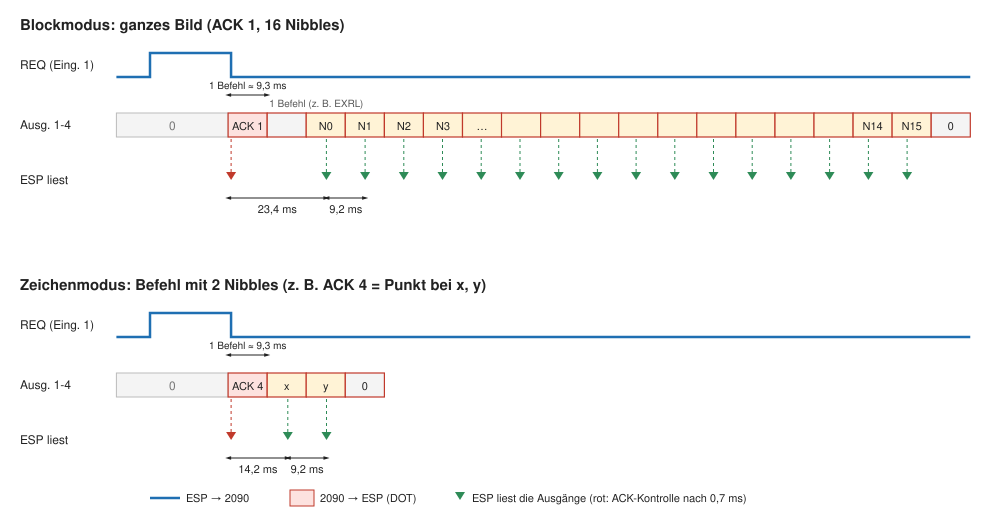
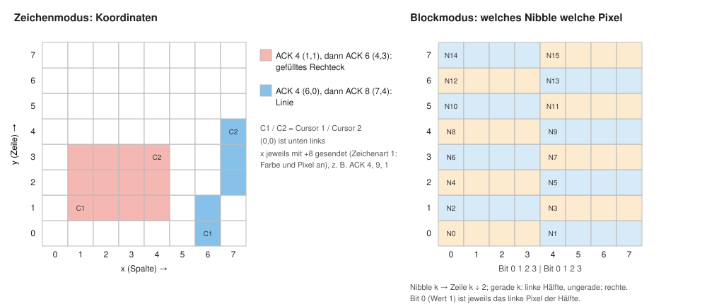

# Die LED-Matrix als Bildschirm für den Microtronic

Die 8x8-LED-Matrix ist ein Sonderfall der Kommunikation über die Ein- und Ausgänge: Der Microtronic schickt Daten über seine vier Ausgänge, das ESP2090-Studio liest sie und zeichnet. Im Unterschied zu den [Userscripts](Userscripts.md) ist das Protokoll fest in die Firmware eingebaut (ab Firmware v1.4, „Protokoll v2“). Auf dem 2090 läuft dafür ein Programm mit einer kleinen Senderoutine, auf dem ESP muss nur die Matrix eingeschaltet sein (**„LED on“** in der Weboberfläche).

Es gibt zwei Arten, die Matrix zu benutzen:

- **Blockmodus:** Der 2090 schickt ein ganzes Bild, 16 Nibbles = 64 Pixel. Das ist das Verfahren aus der ersten Firmware, z. B. für die [BerlinUhr](../program/berlinuhr).
- **Zeichenmodus:** Der 2090 schickt kurze Befehle mit ein oder zwei Nibbles: Punkt, Rechteck, Rahmen, Linie, Farbe, Schieben … So kommt man mit wenigen Befehlen zu bunten Bildern und spart Register.

Beide lassen sich in einem Programm mischen.

## Wie die Übertragung abläuft

Der 2090 hat keinen Takt, den der ESP sehen könnte. Die beiden verabreden deshalb einen Startzeitpunkt, und danach zählt der ESP einfach mit: **bei ausgeschalteter Anzeige (DISOUT) braucht der 2090 für jeden Befehl ziemlich genau 9,3 ms.**



1. **Anfrage (REQ):** Der ESP setzt Eingang 1 des 2090 auf 1. Ein ACK erkennt er erst, nachdem die Ausgänge des 2090 einmal auf 0 standen.
2. **Antwort (ACK):** Der 2090 wartet in einer Schleife auf REQ (`DIN`, `ANDI`, `BRZ`) und legt dann mit `DOT` eine Befehlsnummer 1–15 auf seine Ausgänge. Der ESP erkennt sie, liest nach 0,7 ms zur Kontrolle noch einmal und nimmt REQ zurück.
3. **Daten:** Danach gibt der 2090 in jedem Befehlsschritt ein Nibble mit `DOT` aus. Der ESP liest jeweils in der Mitte des Schritts:
   - **Blockmodus (ACK 1):** Zwischen ACK und erstem Nibble steht genau **ein** Befehl (meist `EXRL`, um die Ablage zu holen). Das erste Nibble liest der ESP 23,4 ms nach dem ACK, dann alle 9,2 ms, insgesamt 16.
   - **Zeichenmodus (ACK 2–15):** Das erste Nibble kommt **direkt im nächsten Schritt**, der ESP liest es nach 14,2 ms, das zweite 9,2 ms später.
4. **Ende:** Der 2090 setzt seine Ausgänge wieder auf 0. Erst danach erkennt der ESP das nächste ACK – ein Wert, der auf den Ausgängen liegen bleibt, wird also nicht doppelt gelesen.

Antwortet der 2090 nicht innerhalb von 30 ms, nimmt der ESP REQ zurück, wartet kurz und fragt erneut. So bleibt die Weboberfläche bedienbar, auch wenn auf dem 2090 gerade kein passendes Programm läuft.

### Drei Regeln für das Programm im 2090

- **Anzeige aus.** Vor jeder Übertragung muss die Anzeige mit `DISOUT` (`F02`) ausgeschaltet sein – nur dann stimmen die 9,3 ms. Wer zwischendurch etwas mit `DISP` anzeigt, schaltet sie vor dem nächsten ACK wieder aus. Am sichersten steht `DISOUT` am Anfang der Senderoutine.
- **Ausgänge am Ende auf 0.** Sonst wartet der ESP vergeblich auf das nächste ACK.
- **CALL nur eine Ebene tief.** Der 2090 merkt sich nur eine Rücksprungadresse. Ein `CALL` innerhalb eines Unterprogramms überschreibt sie, das `RET` landet dann an der falschen Stelle. Unterprogramme dürfen also kein weiteres Unterprogramm per `CALL` aufrufen (ein `GOTO` am Ende ist erlaubt).

## Blockmodus: ein ganzes Bild

Die 16 Nibbles beschreiben die 64 Pixel zeilenweise von unten nach oben. Jede Zeile besteht aus zwei Nibbles: das gerade Nibble für die linke Hälfte, das ungerade für die rechte. Bit 0 (Wert 1) ist jeweils das linke Pixel der Hälfte.



Beispiel: Nibble 0 = `F` und Nibble 1 = `0` schaltet die linke Hälfte der untersten Zeile ein.

Ein Bild zeigt nur, *welche* Pixel leuchten. *In welcher Farbe* sie leuchten, steht in einer zweiten Ebene, der **Farbebene** (am Anfang ist alles rot). Die Farbebene setzt man mit den Befehlen des Zeichenmodus oder aus einem Userscript mit `setColors(...)`.

Die übliche Senderoutine hält die 16 Nibbles in den Registern 0–F und der Ablage 0–7 (so in `film_color` und der BerlinUhr):

```
bild: FD0  DIN R0        ┐ warten auf REQ
      310  ANDI 1,R0     │
      E..  BRZ bild      ┘
      FE0  DOT R0        ACK 1 (R0 ist hier 1)
      F0D  EXRL          der eine Befehl vor den Daten: Nibble 0-7 aus der Ablage holen
      FE0  DOT R0        Nibble 0
      FE1  DOT R1        Nibble 1
      ...
      FEF  DOT RF        Nibble 15
      F0D  EXRL          Ablage zurücktauschen
      FE.  DOT R.        ein Register mit 0: Ausgänge auf 0
      F07  RET
```

## Zeichenmodus: Befehle mit Koordinaten

Ein Befehl besteht aus dem ACK (1–15) und ein oder zwei Datennibbles:

| ACK | Nibbles | Wirkung |
|---|---|---|
| 1 | 16 | ganzes Bild (Blockmodus) |
| 3 | a | ganze Matrix in Zeichenart a (z. B. alles rot, alles aus) |
| 4 | x, y | Cursor 1 setzen und Punkt zeichnen |
| 6 | x, y | Cursor 2 setzen, gefülltes Rechteck zwischen Cursor 1 und 2 |
| 7 | x, y | Cursor 2 setzen, Rechteck als Rahmen |
| 8 | x, y | Cursor 2 setzen, Linie; danach Cursor 1 = Cursor 2 (Linienzug) |
| 10 | k, w | Nibble k (0–15) des Bildes direkt setzen, wie im Blockmodus |
| 11 | r | Bild schieben: 0 links, 1 rechts, 2 hoch, 3 runter; +8 mit Umlauf |
| 14 | f | aktive Farbe 0–15 wählen (siehe Palette) |
| 15 | w | Anzeige: 1 umschalten, 2 an, 3 aus (gezeichnet wird weiter) |

ACK 2, 5, 9, 12 und 13 haben keine Bedeutung und werden ignoriert.

**Koordinaten:** x ist die Spalte (0 links bis 7 rechts), y die Zeile (0 unten bis 7 oben). Eine Koordinate braucht nur 3 Bit – das vierte Bit (Wert 8) wird für die **Zeichenart** benutzt:

| x +8 | y +8 | Zeichenart | Wirkung |
|---|---|---|---|
| – | – | 0 | nur die Farbe merken (Pixel bleiben, wie sie sind) |
| ✓ | – | 1 | Farbe setzen und Pixel an (mit Farbe 0 = schwarz: Pixel aus) |
| – | ✓ | 2 | nur Pixel an, Farbe bleibt (einen Ausschnitt zeigen) |
| ✓ | ✓ | 3 | nur Pixel aus, Farbe bleibt (einen Ausschnitt ausblenden) |

Im Bild oben links: `ACK 4` mit x = 1+8, y = 1 setzt Cursor 1, dann zeichnet `ACK 6` mit x = 4+8, y = 3 das gefüllte Rechteck in der aktiven Farbe. Die blaue Linie entsteht aus `ACK 4` (6+8, 0) und `ACK 8` (7+8, 4). Cursor 1 zeichnet seinen Punkt in derselben Zeichenart – für eine Figur also beide Cursor mit denselben +8-Bits senden. Soll Cursor 1 nur gesetzt werden, ohne dass etwas erscheint, schickt man ihn ohne +8 (Zeichenart 0).

**Palette** (für ACK 14, Farbnummer f):

| 0 | 1 | 2 | 3 | 4 | 5 | 6 | 7 |
|---|---|---|---|---|---|---|---|
| schwarz | rot | orange | gelb | grün | türkis | blau | violett |

| 8 | 9 | 10 | 11 | 12 | 13 | 14 | 15 |
|---|---|---|---|---|---|---|---|
| magenta | weiß | dunkelrot | dunkelgrün | dunkelblau | oliv | rosa | grau |

Ein Userscript kann jede dieser Farben mit `setPalette(nummer, (r, g, b))` ändern.

### Die Senderoutine für den Zeichenmodus

Eine einzige Routine genügt für alle Befehle. Das ACK steht in R1, die Daten in R2 und R3:

```
cmd:   F02  DISOUT        Anzeige aus (Pflicht)
warte: FD0  DIN R0        ┐ warten auf REQ
       310  ANDI 1,R0     │
       E..  BRZ warte     ┘
       FE1  DOT R1        ACK
       FE2  DOT R2        Nibble 1 (x bzw. Wert)
       FE3  DOT R3        Nibble 2 (y); bei Befehlen mit einem Nibble ohne Bedeutung
       100  MOVI 0,R0
       FE0  DOT R0        Ausgänge auf 0
       F07  RET
```

Für jeden Befehl gibt es dann einen kurzen Einsprung, der R1 setzt und zu `cmd` springt, zum Beispiel `punkt: 141 C..` (R1 = 4, `GOTO cmd`). Ein roter Punkt bei (3, 4) ist damit:

```
1E1  MOVI E,R1    ACK 14 = Farbe
112  MOVI 1,R2    Farbe 1 = rot
B..  CALL cmd
1B2  MOVI B,R2    x = 3 + 8 (Zeichenart 1: Farbe und Pixel an)
143  MOVI 4,R3    y = 4
B..  CALL punkt
```

## Beispiele

| Programm | Was es zeigt |
|---|---|
| [demo_matrix](../program/demo_matrix) | Vorführung aller Zeichenbefehle: Jede Taste am 2090 zeigt die nächste (ganze Matrix, Punkt, Rechteck, Rahmen, Ausschnitt aus-/einblenden, Linienzug, Schieben, Anzeige an/aus, Glitter, bunte Vielecke, Rahmen mit laufenden Farben, Regenbogen, Feuerwerk). 209 Befehle. |
| [film_color](../program/film_color) | Ein kleiner Film mit farbigen Pixeln: Bilder im Blockmodus, Farben im Zeichenmodus. Nutzt alle 256 Befehle. |
| [berlinuhr](../program/berlinuhr) | Die Berliner Mengenlehreuhr, nur im Blockmodus; die Farben setzt das Userscript `farbmatrix.py`. |

Zu jedem Programm gibt es die `.mic`-Datei zum Hochladen (Knopf **Upload** in der Weboberfläche) und den Quelltext `.src` mit Sprungmarken und Mnemonics in der Schreibweise des LibreOffice-Assemblers von Martin Sauter.

**So startest du ein Beispiel:** `.mic`-Datei mit **Upload** zum 2090 übertragen, Programm auf dem 2090 starten, in der Weboberfläche **LED on** drücken. Die Matrix erscheint auch live in der Weboberfläche.

## Ältere Programme umstellen

Programme für die Firmware vor v1.4, die nur ganze Bilder schicken, laufen unverändert. Wer Farb- oder Cursorbefehle benutzt hat, muss anpassen:

- Cursor und Rechteck: x und y jetzt in **einem** Befehl (ACK 4, 6, 7, 8).
- Farbwahl jetzt mit **ACK 14** (früher 15), Farbnummern +1 (rot = 1, schwarz = 0).
- Das +8 an den Koordinaten bedeutet jetzt „sofort sichtbar“ (Zeichenart 1). Für das alte Verhalten (nur die Farbe merken) ohne +8 senden.
- In Userscripts erwartet `setColors` eine Liste mit 64 Farbnamen (oberste Zeile zuerst).
